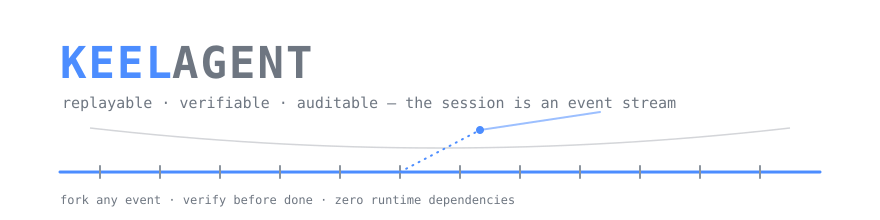

<div align="center">



**可回放、可验证、可审计的编码智能体 CLI。**

事件溯源会话 · 证据驱动完成 · 零运行时依赖

[English](./README.md) · **中文**


</div>

---

Keel 是一个把**会话当作只追加事件日志**、把**"完成"当作可验证契约**的 coding agent harness。OpenAI 兼容接口通吃 DeepSeek / GLM / Kimi / Qwen / OpenAI，零运行时依赖安装，退出码可被 CI 直接依赖。

```
keel run "修复登录超时的 bug，并确保测试通过"
```

## 为什么再做一个 agent CLI

Keel 面向 CI 与自动化代码维护，用一个小型执行内核提供三个明确的执行约定，外加一组隔离、闸门与撤销 agent 行为的控制。

### 1. 会话即事件流（event-sourced session）

Keel 的会话是一条 **append-only 事件流**（`~/.keel/sessions/<id>/events.jsonl`），LLM 请求/响应、策略判定、工具调用、验证证据、上下文压缩全部是带序号的事件；对话历史、花费、验证状态全部是对事件的 **fold（纯推导）**。

同一份历史支持：

- **`keel fork <id> --at <seq>`**：从任意事件分叉出新会话；不会复制或回滚工作目录文件
- **`keel replay <id>`**：只读回放完整执行轨迹（含每步策略判定与成本）
- **`keel cost <id>`**：按模型/回合的费用审计，精确到每次 LLM 调用
- **`plan` 规划工具**：计划也是事件——每次更新落进事件流，回放可见计划的演变，fork 后计划状态随之回溯
- **上下文压缩只是视图替换**：模型收到摘要后，事件流仍保留已记录的完整历史

### 2. 证据驱动的完成契约（evidence-driven done）

只要执行过可能修改文件的工具（write/edit/bash，包括失败或中断），模型声明完成前必须调用 `verify` 工具跑通验证（测试/构建/脚本），证据落盘 `evidence/` 目录。配置的 `verify.commands` 是必跑检查，模型追加的命令先执行、配置检查最后执行。后续验证失败、分叉或新一轮用户输入会使旧证据失效，因为工作目录或验证配置可能已在会话外变化。没验证就想收工会被打回（最多 2 次），最终仍无证据则以 `unverified` 结束并给出**非零退出码**——CI 里可以直接依赖这个信号。它证明配置的命令通过，不能证明所有需求已满足。

### 3. 策略先行、全程审计

所有工具调用先过声明式策略引擎再执行，判定本身也作为事件落盘：

- `denyPaths`：路径黑名单（默认 `.env`、私钥），**读和写都拦**
- `bashDeny` / `bashApprove`：命令直接拒绝 / 需人工确认
- `readOnly`：只读模式
- `protectPaths` / `writePaths` / `approvePaths`：可读不可写（默认 `.keel.json`，agent 改不了自己的策略）、写入白名单、写入需人工审批
- 预算熔断：会话花费超上限自动停

### 4. 隔离、闸门、撤销

控制不止于提示词和模式匹配：

- **bash/verify 的 OS 沙箱**（`sandbox.mode: "workspace-write"`）：macOS seatbelt / Linux bubblewrap。命令只能写工作目录（或 `writePaths`）与临时目录，读不到 `denyPaths` 里的密钥，改不了 `protectPaths` 和 `.git`，读写不了 Keel 事件库，`sandbox.network` 未开启时没有外网。要求开启沙箱但本机不可用时直接拒绝执行，不会裸跑。每个 `tool.call` 都记录实际所在的沙箱。
- **preTool hooks**（`hooks.preTool`）：工具执行前，你的脚本以 JSON 收到调用内容，可以拒绝或升级为人工审批。hook 只能收紧内置策略；崩溃、超时、输出非法一律拒绝。每个 hook 的判定都写进 `policy.decision` 事件。
- **检查点**：每次 write/edit 都以内容寻址保存前后快照（`file.changed`）。`keel diff` 输出会话补丁；`keel rewind` 把文件恢复到任意事件（默认撤销最近一轮），磁盘内容与检查点不一致时拒绝覆盖（`--force` 才覆盖）。`keel fork --at <seq> --rewind` 同时分叉历史**和**文件。bash 的副作用不在快照内，`keel diff` 会提示。
- **机器可读运行**：`keel run --json` 把每个事件以 JSONL 实时写到 stdout，供编排方消费。

## 能力范围

| 关注点 | Keel 提供 | 部署方负责 |
|---|---|---|
| 完成判定 | 验证事件与退出码 | 可信的独立验收测试 |
| 恢复 | 本机会话锁、可续跑历史、明确的未知工具结果 | 每任务独立工作目录，核对中断后的副作用 |
| 隔离 | 工具策略检查；可选的 bash/verify OS 沙箱 | 不可信仓库用容器/VM、资源硬限制 |
| 资源 | 请求/工具超时、响应间预算检查 | 作业截止时间、资源硬限制与供应商额度 |

Keel 的方向是让这些约定易于检查和集成，保持零 npm 运行时依赖。当前证据支持受控试运行，详见[验证结果与限制](./VALIDATION.md)。

## 快速开始

```bash
git clone https://github.com/dangzitou/keel-agent.git
cd keel-agent && npm install && npm run build
export ZHIPU_API_KEY=sk-...   # 或 STEPFUN_API_KEY / DEEPSEEK_API_KEY 等
node dist/index.js            # 交互式 REPL——模型根据你 export 的 key 自动匹配
```

零配置文件：环境里有哪些 provider 的 key，keel 就自动选合理的默认模型。`node dist/index.js run "任务"` 单发模式、`continue` 继续最近会话、`-m <provider/model>` 临时换模型。

没有 API key 也能体验完整链路（确定性 mock 模型）：

```bash
KEEL_MOCK=1 node dist/index.js run "写个 hello"
```

## CLI

| 命令 | 作用 |
|---|---|
| `keel` | 交互式 REPL（`--session <id>` 继续会话） |
| `keel continue` | 继续最近一个会话 |
| `keel run "<任务>"` | 单任务模式；`unverified` 时退出码 3，失败退出码 1（`--session <id>` 续跑，`-m <ref>` 换模型，`--yes` 自动放行审批，`--json` 以 JSONL 输出事件流） |
| `keel sessions` | 列出会话（回合数、花费、⚠未验证修改标记） |
| `keel replay <id>` | 只读回放事件流 |
| `keel fork <id> [--at <seq>] [--rewind]` | 从第 seq 个事件分叉新会话；`--rewind` 同时把检查点内的文件恢复到断点 |
| `keel diff [id] [--at <seq>]` | 自事件 seq（默认会话开始）以来 write/edit 改动的统一 diff |
| `keel rewind [id] [--at <seq>] [--force]` | 把检查点内的文件恢复到事件 seq（默认撤销最近一轮） |
| `keel cost <id>` | 成本报告 |
| `keel doctor` | 环境体检：node 版本、配置、密钥、价目、验证命令、目录可写性 |
| `keel init` | 生成配置模板 |

REPL 内命令：`/help /new /sessions /plan /replay /fork /cost /diff /rewind /policy /exit`。

**退出码约定**（给 CI 用）：`0` done · `1` 失败/预算/超轮次 · `3` 存在未验证修改 · `130` 被中断。

**恢复设计**：每会话仅允许一个本机写入者；JSONL 追加后同步落盘，元数据原子替换；续跑时为未完成的工具批次补记“结果未知”，不自动重放副作用。未提交的尾部字节先归档再恢复，已提交事件损坏则拒绝继续。fork 复制历史与计划，**不会回滚工作目录文件**。分叉及新一轮用户输入会使旧的成功证据失效，即使只读复查，也需重新验证。锁接管中再次崩溃也可恢复。文件工具拒绝 FIFO 等特殊文件，read/edit/搜索只读取不超过 2 MB 的普通文件。

**可靠性设计**：LLM 调用对 429/5xx/网络错误做指数退避重试（`llm.retries`，尊重 `Retry-After`），单请求超时可配（`llm.timeoutMs`）；每次重试落 `llm.retry` 事件可审计。Ctrl+C 触发 AbortSignal 全程传导——进行中的 fetch 与 bash 进程组被终止，`turn.completed(aborted)` 完整落盘，`keel run` 以退出码 130 结束。回合进行中在 REPL 输入的文本会排队，不丢弃；EOF 会排空队列；非交互审批默认拒绝，只有 `--yes` 才放行。单发与 REPL 入口都支持 SIGTERM 可审计收尾。

`bash`/`verify` 按前台任务执行：shell 退出时清理同进程组的后台子进程，不保留常驻服务。`grep` 的正则在可终止的工作线程中执行，搜索限时 5 秒，达到结果上限即停止遍历。长历史分段完整摘要，每段检查预算；全部成功才替换上下文，失败或中途超预算保留原视图。

## 配置

最轻的方式零配置文件——环境变量直配，优先级最高：

```bash
# 直接引用内置 provider
KEEL_MODEL=glm-anthropic/glm-5.3 keel run "..."
KEEL_MODEL=stepfun/step-5-preview keel run "..."

# 或任意自定义端点（api: openai | anthropic | responses）
KEEL_MODEL=my-model KEEL_BASE_URL=https://gw.example/v1 KEEL_API_KEY=sk-... KEEL_API=anthropic keel run "..."
```

原生支持三种线协议：OpenAI chat/completions、Anthropic Messages、OpenAI Responses，按 provider 用 `api` 字段指定。内置 provider：`deepseek`、`zhipu`、`glm-anthropic`（智谱 Anthropic 网关）、`stepfun`（Responses）、`moonshot`、`qwen`、`openai`。

否则用全局 `~/.keel/config.json` 与项目 `.keel.json` 合并（项目优先）：

```jsonc
{
  "providers": {
    "stepfun": { "baseURL": "https://api.stepfun.com/step_plan/v1", "apiKeyEnv": "STEPFUN_API_KEY", "api": "responses" }
  },
  "router": { "main": "stepfun/step-5-preview", "fast": "deepseek/deepseek-chat" },
  "budget": { "maxUsdPerSession": 2, "maxTokensPerSession": 1000000 },
  "llm": { "retries": 3, "timeoutMs": 600000, "stream": true },
  "verify": { "commands": ["npm test"] },
  "policy": {
    "denyPaths": ["**/.env", "**/*.pem"],
    "bashDeny": ["sudo *"],
    "bashApprove": ["git push*"],
    "readOnly": false,
    "constrainToWorkspace": true,
    "protectPaths": [".keel.json", "test/**"],
    "writePaths": [],
    "approvePaths": ["package.json"]
  },
  "sandbox": { "mode": "workspace-write", "network": false, "writablePaths": [] },
  "hooks": { "preTool": [{ "command": "./scripts/keel-gate.sh", "tools": ["bash", "write", "edit"] }] },
  "context": { "compactThresholdTokens": 48000, "keepRecentMessages": 6 },
  "maxTurns": 40
}
```

**Hook 协议**：命令在工作目录执行（移除 provider 密钥；属于运维方配置，不进沙箱），stdin 收到 `{"event":"preTool","session","cwd","tool","input","policy":{"decision","rule"}}`。exit `0` 放行，可在 stdout 输出 `{"decision":"allow"|"approve"|"deny","reason":"..."}`；exit `2` 拒绝，stderr 作为理由；其它情况一律拒绝。多个 hook 依次执行，遇到 deny 即停，默认超时 30 秒（`timeoutMs`）。

**沙箱说明**：`writePaths` 同样约束沙箱内的 bash，设置时记得包含构建产物（如 `dist/**`）。工作目录外的工具缓存（`~/.npm`、`~/.cache`）默认只读，需要时加进 `sandbox.writablePaths`。Linux 下保护与禁止路径在命令启动时 bind mount，只覆盖已存在的文件。`keel doctor` 会报告本机可用的沙箱。

`router.main` 干活，`router.fast` 做上下文压缩等便宜活——路由是一等公民，多模型是调度而非"支持"。API key 只从环境变量读取（`providers.<name>.apiKeyEnv` 指定变量名），不落配置文件。

未知价目会在事件与成本报告中标记，美元合计可能不完整；默认仍有 **1,000,000 会话 token 上限**（`budget.maxTokensPerSession` 可调，`0` 关闭）。自定义费率可配置 `pricing`，格式为 `"provider/model": { "input": 每百万输入token的美元价格, "output": 每百万输出token的美元价格 }`，订阅模型可显式配置零费率。预算在请求前、压缩后、响应后检查；单次在途响应可能超出上限。内置价格仅为估算，不是供应商账单。

## 架构

```text
src/
├── events/types.ts     # 19 种事件类型（版本化 schema）
├── core/
│   ├── store.ts        # append-only JSONL 存储（~/.keel/sessions/<id>/）
│   ├── fold.ts         # 状态 = fold(事件)：消息/花费/验证状态/计划/文件改动
│   ├── checkpoint.ts   # 文件快照 → 任意 seq 的状态、diff、rewind
│   └── loop.ts         # agent 循环：完成契约、预算熔断、上下文压缩
├── llm/
│   ├── provider.ts     # OpenAI 兼容客户端 + 确定性 mock
│   ├── anthropic.ts    # Anthropic Messages 协议客户端
│   ├── responses.ts    # OpenAI Responses 协议客户端
│   ├── http.ts         # 共用 POST / SSE / 中断语义
│   ├── router.ts       # main/fast 角色路由
│   └── cost.ts         # 价目表与计费
├── policy/policy.ts    # 声明式策略引擎（deny/approve/allow）
├── policy/hooks.ts     # 外部 preTool 闸门（只能收紧）
├── tools/              # plan/read/write/edit/bash/glob/grep/verify
│   └── sandbox.ts      # bash/verify 的 seatbelt / bubblewrap 隔离
├── ui/render.ts        # 终端渲染 + 事件回放渲染
└── index.ts / repl.ts / commands.ts
```

**事件 schema**（信封 `seq / id / ts / session / parent / forkedAtSeq / type / data`，19 种 type：`session.started`、`user.message`、`system.note`、`llm.request`、`llm.response`、`llm.retry`、`tool.call`、`tool.result`、`plan.updated`、`policy.decision`、`file.changed`、`workspace.rewound`、`verify.started`、`verify.result`、`verify.invalidated`、`context.compacted`、`turn.completed`、`budget.exceeded`、`error`）。

关键设计约束：

- 事件只追加、不改写；fork 是复制前缀，不是改历史
- 任何状态都可从事件重放推导，所以重放本身就是回归测试
- harness 的不变量（完成契约、策略、预算）在 loop 层强制，不依赖提示词自觉

## 安全边界（务必阅读）

Keel 是策略层 + 审计层，shell 命令的 OS 沙箱需**主动开启**：

- `constrainToWorkspace`（默认开）约束 read/write/edit/glob/grep。**`sandbox.mode: "off"`（默认）时 bash 不受路径约束**——`cat /etc/passwd` 这类命令绕过路径策略，依赖 `bashDeny`/`bashApprove` 与人工审批；开启沙箱后 bash/verify 的写入、密钥读取与外网都被限制
- 沙箱仍允许读取工作目录外的文件（如 `/etc`、家目录），只屏蔽 `denyPaths` 与 Keel 事件库；它不是 VM，也不限制 CPU/内存
- `verify` 命令同样经过 bash 的拒绝/审批/只读检查；glob/grep 过滤禁止文件；路径检查解析符号链接，包括尚未创建的写入目标
- bash/verify 子进程环境移除 harness 的 provider 密钥；会话目录/文件创建时采用仅所属用户可访问的权限
- `bashDeny`/`bashApprove` 是朴素模式匹配，可被引号/变量绕过，是最低保障而非安全边界
- 处理不可信仓库时仍应把 keel 放进容器/VM（roadmap：内置 worktree/容器隔离）；hooks 是可信的运维方代码，不在沙箱内运行
- 事件流会记录工具输入（含 write 的完整文件内容），敏感仓库注意会话目录的访问权限与留存策略
- 模型可能被仓库内容注入指令：完成契约与策略层是兜底，高危操作请保持审批开启

**平台**：macOS / Linux（bash 依赖）。

## 测试与 CI

```bash
npm test    # 回归用例：glob/策略/fold/fork/重试/流式聚合/plan/双协议（anthropic 与 responses）+ mock 全链路（契约打回、预算熔断、策略拦截）
            # + 本地 SSE 服务器集成测试（chatStream 消费真实流式分片、agent loop 全链路走真实 SSE）
            # + 真实 SIGINT 投递测试（keel run 子进程 exit 130 + aborted 事件落盘）
            # + 控制面：写入范围、hooks（拒绝/升级/失败即拒）、检查点/rewind/fork --rewind、
            #   真实 seatbelt/bwrap 隔离（本机无沙箱时跳过）、--json 事件流
```

GitHub Actions 在 Node 20/22/24 上跑 build + test + mock 模式端到端 smoke。

真实模型评测需主动运行，会建立临时项目并消耗供应商额度：

```bash
export STEPFUN_API_KEY=...
npm run eval:stepfun  # 三次独立修复、流式/非流式、续跑与分叉、独立产物断言
npm run eval:repo     # 在仓库独立副本中修复两个注入回归，再由外部执行验收
```

## Roadmap

- what-if 分叉：替换某个工具结果后重跑（fork 的完全体）
- worktree/容器隔离：planner-worker 多任务隔离执行，产出分支/PR（bash 的 OS 沙箱已完成）
- 会话回归集：把历史会话导出为评测用例（`exportEvents` 已留口）
- 子代理、MCP 兼容层、Windows 支持

## 参与贡献

Keel 刻意保持小体积，贡献也应保持小——见 [贡献指南](./CONTRIBUTING.zh-CN.md)（[English](./CONTRIBUTING.md)）。最重要的规则只有一条：一切状态必须仍能只从事件流推导。适合上手的切入点：provider 预设、回放渲染、运行时级测试、真实使用故事。

## 状态

实验阶段（v0.3.0），已补齐关键可靠性检查，公开开发。实测证据与运行限制见 [VALIDATION.md](./VALIDATION.md)。事件 schema、CLI 与配置已可用但仍可能变化。Keel 是一个探索"纯事件溯源能把 agent harness 带多远"的个人项目——欢迎提 issue 和讨论。

## 许可

[MIT](./LICENSE) © 2026 dangzitou
